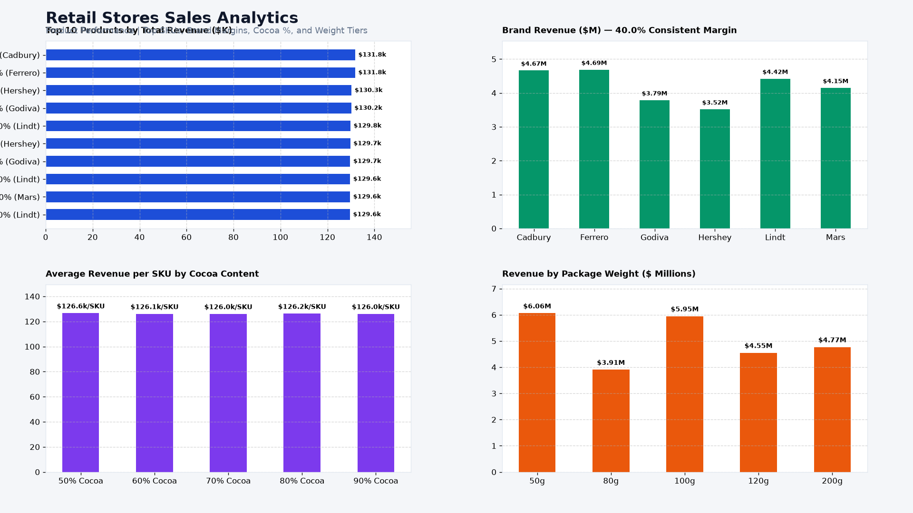
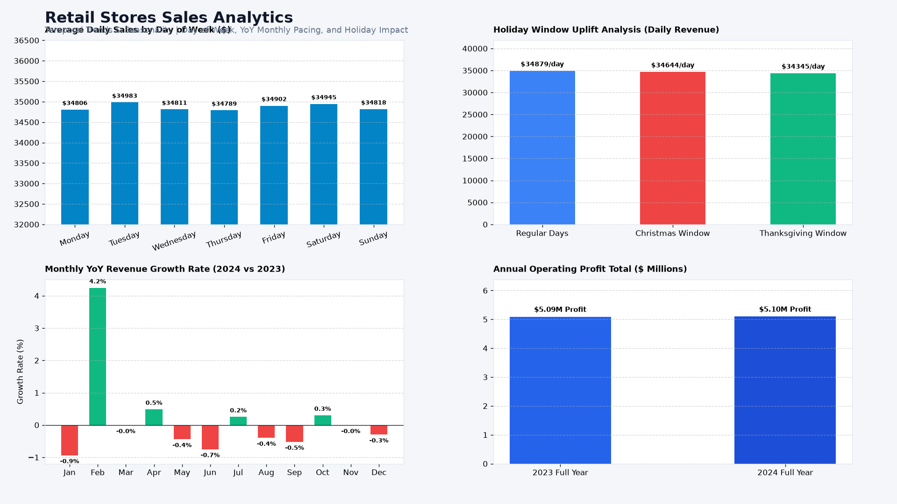

# 🍫 Retail Stores Sales Analytics (2023–2024)

[](https://www.python.org/)
[](https://www.mysql.com/)
[](https://powerbi.microsoft.com/)
[](https://pandas.pydata.org/)
[]()
[]()

An end-to-end commercial retail sales analytics portfolio project demonstrating database modeling, empirical data quality auditing, exploratory data analysis (EDA), complex SQL querying, DAX modeling, and executive dashboard development across **1,000,000 transactions**.

---

## 📌 Executive Summary & Key Results

Over the 2023–2024 operating period (731 calendar days), the retail chocolate business generated **$25,486,128.86 in gross revenue** and **$10,194,564.63 in operating profit** across 100 stores and 200 catalog SKUs, achieving an overall operating margin of **40.00%**.

| Portfolio Metric | Validated Value | Benchmark Notes |
|---|---|---|
| **Total Gross Revenue** | **$25,486,128.86** | Cross-validated across MySQL, Pandas, and Power BI |
| **Total Operating Profit** | **$10,194,564.63** | Total COGS: $15,291,554.40 |
| **Overall Profit Margin** | **40.00%** | Consistent ~40.0% operating margin across brands |
| **Total Orders** | **1,000,000** | Distinct transactional order line items |
| **Total Volume Sold** | **2,999,589 units** | Average basket size of 3.00 units/order |
| **Average Order Value (AOV)**| **$25.49** | Stable basket size across customer segments |
| **Average Selling Price (ASP)**| **$8.50** | Realized net price per chocolate unit |
| **Active Customer Base** | **50,000 customers** | Average 20 transactions & $509.72 spend per customer |
| **Retail Store Network** | **100 facilities** | 4 channel formats across 7 metropolitan markets |

---

## 📊 Power BI Executive Dashboard

The interactive Power BI report is structured into 4 decision-focused pages, modeling business performance from high-level C-suite KPIs down to SKU-level velocity and customer segmentation.

### Page 1: Executive Overview
*High-level portfolio financial KPIs, monthly pacing (2023 vs 2024), category revenue split, brand sales, and channel breakdown.*


---

### Page 2: Product & Brand Performance
*Top 10 revenue-generating SKUs, brand margin efficiency matrix, cocoa percentage tier analysis, and package weight distribution.*


---

### Page 3: Customer Demographics & Store Operations
*Customer age bracket spend, gender distribution, loyalty membership comparison, and average store productivity.*


---

### Page 4: Sales Trends & Seasonality
*Day-of-week revenue variance, holiday uplift analysis (Christmas and Thanksgiving), and year-over-year monthly growth trajectories.*


---

## 🛠️ Technology Stack

| Layer | Technology | Primary Functionality |
|---|---|---|
| **Database Engine** | **MySQL 8.0** | DDL schema design, staging architecture, constraints, indexing, and business querying with CTEs and window functions (`RANK`, `ROW_NUMBER`, `LAG`). |
| **Exploratory Analytics** | **Python 3.11 / Pandas / NumPy** | Data ingestion, mathematical formula validation, statistical distributions, and hypothesis testing. |
| **Data Visualization** | **Matplotlib / Seaborn** | Publication-grade statistical plots, formatting engines, and chart interpretations. |
| **Business Intelligence** | **Microsoft Power BI Desktop** | Star schema relationship architecture, VertiPaq tabular modeling, 23 reusable DAX measures. |
| **ETL & Data Prep** | **Power Query (M)** | Type safety enforcement, portable data-source configuration, and orphan key mitigation. |
| **Version Control** | **Git / GitHub** | Reproducible project structure, documentation, and version control. |

---

## 📁 Repository Architecture

```text
Retail_Stores_Analysis/
├── .gitignore                          # Excludes raw data while tracking deliverables
├── README.md                           # Master executive summary and project documentation
├── requirements.txt                    # Locked Python dependency specifications
│
├── data/
│   └── raw/
│       └── README.md                   # Instructions and Kaggle link for raw dataset
│
├── docs/
│   ├── project_brief.md                # Project charter, scope, and objectives
│   ├── dataset_audit.md                # Complete empirical data quality audit & anomaly log
│   ├── schema_design.md                # Star schema architecture, ERD, and data dictionary
│   ├── question_bank.md                # 20 business-critical analytical questions
│   ├── insights.md                     # Detailed analytical findings and strategic takeaways
│   └── Schema_Design.png               # High-resolution entity relationship diagram
│
├── powerbi/
│   ├── DAX_Measures.md                 # 23 DAX measures with verified benchmarks
│   ├── Retail_Stores_Sales_Analysis.pbip  # Power BI Project definition file
│   ├── Retail_Stores_Sales_Analysis.pbit  # Portable Power BI Template file
│   ├── Retail_Stores_Sales_Analysis.pbix  # Standalone Power BI Report
│   ├── Retail_Stores_Sales_Analysis.Report/   # PBIP report layout and visual containers
│   └── Retail_Stores_Sales_Analysis.Dataset/  # PBIP Tabular Model definitions (model.bim)
│
├── python/
│   └── notebooks/
│       └── 01_sales_eda.ipynb          # Clean, fully executed end-to-end Python EDA notebook
│
├── screenshots/                        # High-resolution dashboard page screenshots
│   ├── 01_executive_overview.png
│   ├── 02_product_performance.png
│   ├── 03_customer_store_analysis.png
│   └── 04_sales_trends.png
│
└── sql/                                # Modular, production-ready SQL scripts
    ├── 00_database_setup.sql           # Database creation, staging DDL, and PK/FK definitions
    ├── 01_data_audit.sql               # Data quality, nulls, duplicates, and orphan checks
    ├── 02_product_brand_analysis.sql   # SKU rankings, brand performance, and category CTEs
    ├── 03_customer_analysis.sql        # Age cohort segmentation, gender, and loyalty queries
    ├── 04_store_performance.sql        # Channel format analysis, store productivity, and cities
    └── 05_sales_trends.sql             # Monthly trends, YoY growth rates, and holiday windows
```

---

## 🔍 Data Quality Auditing & Limitations

A senior-level data analysis project does not overlook data anomalies. Our empirical audit uncovered several critical source-level characteristics:

1. **Orphan Product Identifiers (`P0000` & `P0201`):**
   - Exactly **9,764 transaction records** (0.98% of total volume) reference product IDs `P0000` (4,895 records; $124,196.82 revenue) and `P0201` (4,869 records; $123,283.82 revenue) which do not exist in the 200-row `products` catalog.
   - *Handling:* Rather than deleting valid sales representing **$247,480.64 in gross revenue**, these records are handled via `COALESCE` / `IF(ISBLANK())` in SQL and Power BI as `Unassigned SKUs`. Table DDL omits rigid product foreign keys to preserve full data integrity.
2. **Exact One-Cent Discrepancies vs. Discrepancies Greater Than One Cent:**
   - **Revenue:** 8,921 records differ from `quantity * unit_price * (1 - discount)` by **exactly $\pm \$0.01$** (4,579 negative, 4,342 positive). Exactly **0 rows** differ by more than one cent.
   - **Profit:** 85,479 records differ from `revenue - cost` by **exactly $\pm \$0.01$** (42,248 negative, 43,231 positive). Exactly **0 rows** differ by more than one cent.
   - *Handling:* Sourced from floating-point rounding during synthetic generation; recorded transaction values are preserved as the ground-truth financial ledger.
3. **Geographic Incoherence (80% Discordance):**
   - 80 out of 100 stores pair cities and countries randomly (e.g., Paris assigned to UK, Berlin to France, Melbourne to Canada).
   - *Handling:* Documented as a synthetic artifact; city and store-type metrics are evaluated independently rather than as a strict geographic hierarchy.
4. **Synthetic Uniformity:**
   - Day-of-week sales vary by less than **0.6%** ($34,788.94 to $34,982.97 per day).
   - Holiday windows (Christmas, Thanksgiving) display no statistically significant sales surge.
   - All 6 brands capture revenue with consistent ~40.0% margins.
   - *Handling:* Findings are explicitly classified as descriptive characteristics of the dataset, avoiding unsupported causal claims.

*Detailed documentation: [`docs/dataset_audit.md`](docs/dataset_audit.md)*

---

## 💡 Key Business Findings & Strategic Recommendations

1. **Assortment Uniformity:** Ferrero ($4.69M), Cadbury ($4.67M), Lindt ($4.42M), and Mars ($4.15M) lead catalog revenue with consistent margins. Top SKUs (P0091 Dark Chocolate 60% and P0107 Truffle 80%) cluster around $131K each.
2. **Channel Productivity:** While Airport (30 stores) and Mall (26 stores) represent the highest store counts, **all four channel formats** produce identical store-level productivity (~$254K to $256K per store over 2 years).
3. **Loyalty Program Observations:** Recorded loyalty members and non-members average identical basket sizes ($25.45 vs $25.52) and 2-year spend ($508.80 vs $510.65), showing no spending divergence in this dataset.
4. **Actionable Recommendations:**
   - *POS Catalog Clean-Up:* Reconcile orphan SKUs `P0000` and `P0201` in the master product catalog to eliminate untracked sales ($247K revenue).
   - *Loyalty Program Restructuring:* Introduce minimum spend hurdles and tier-exclusive seasonal bundles to convert passive members into higher-frequency buyers.
   - *Channel Optimization:* Capitalize on digital and airport channel expansion, which yield identical margins (40.0%) with lower brick-and-mortar overhead.

*Detailed report: [`docs/insights.md`](docs/insights.md)*

---

## 🚀 How to Reproduce & Run the Project

### 1. Clone the Repository
```bash
git clone https://github.com/Devendra-afk/Retail_Stores_Analysis.git
cd Retail_Stores_Analysis
```

### 2. Obtain Raw Data
Download the 5 CSV files from [Kaggle Chocolate Sales Dataset 2023–2024](https://www.kaggle.com/datasets/ssssws/chocolate-sales-dataset-2023-2024) and place them into `data/raw/`:
- `sales.csv` (1,000,000 rows)
- `products.csv` (200 rows)
- `customers.csv` (50,000 rows)
- `stores.csv` (100 rows)
- `calendar.csv` (731 rows)

### 3. Run SQL Analysis (MySQL)
Execute the organized scripts in sequential order:
```sql
SOURCE sql/00_database_setup.sql;
SOURCE sql/01_data_audit.sql;
SOURCE sql/02_product_brand_analysis.sql;
SOURCE sql/03_customer_analysis.sql;
SOURCE sql/04_store_performance.sql;
SOURCE sql/05_sales_trends.sql;
```

### 4. Execute Python EDA Notebook
Install dependencies and run the Jupyter notebook:
```bash
pip install -r requirements.txt
jupyter notebook python/notebooks/01_sales_eda.ipynb
```

### 5. Open Power BI Dashboard
Open `powerbi/Retail_Stores_Sales_Analysis.pbix` (or `Retail_Stores_Sales_Analysis.pbip`) in Microsoft Power BI Desktop to explore the interactive visual model and 23 DAX measures.

---

## 👨‍💻 Author & Contact

**Devendra**  
*Aspiring Data Analyst | SQL, Python, Power BI, Excel*  
- **GitHub:** [@Devendra-afk](https://github.com/Devendra-afk)  
- **Project Repository:** [Retail_Stores_Analysis](https://github.com/Devendra-afk/Retail_Stores_Analysis)

*Open to Data Analyst Internship and Junior Analytics opportunities.*
