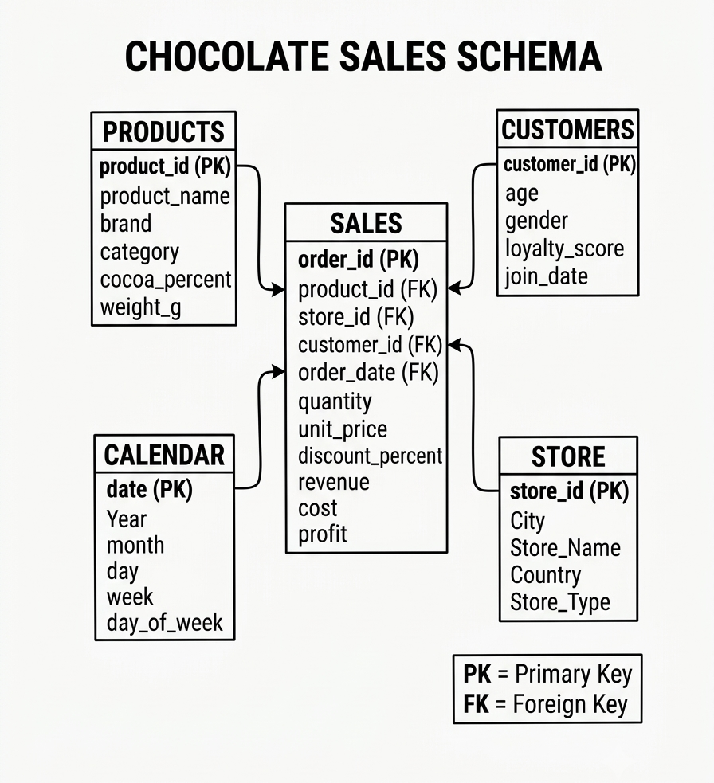

# Schema Design - Retail Store Analysis

## 1. Overview

This document describes the data model used in the Retail Store Analysis project. The dataset consists of five CSV files: `sales.csv`, `products.csv`, `customers.csv`, `stores.csv`, and `calender.csv`.

The schema is designed to support sales analysis across products, customers, stores, and time. It enables business analysis of product demand, brand performance, customer purchasing patterns, store performance, and seasonal sales trends.

## 2. Data Model

The project follows a dimensional data model, with the sales table acting as the central fact table and the remaining tables providing descriptive information for analysis.

### Entity Relationship Diagram

### Tables

| Table | Purpose |
|---|---|
| `sales` | Stores sales transaction or sales-record data and connects sales to the relevant dimensions. |
| `products` | Contains product-related attributes such as brand, category, cocoa percentage, and weight, where available. |
| `customers` | Contains customer attributes such as age, gender, or other demographic information, where available. |
| `stores` | Contains store-related details such as location, city, and store type, where available. |
| `calender` | Contains date-related attributes used to analyze sales over time, including seasonal and weekday trends. |

*Note: The exact attributes and column names should match the source CSV files.*

## 3. Primary Keys and Foreign Keys

Primary keys uniquely identify records in their respective tables. Foreign keys establish relationships between the sales data and the corresponding dimension tables.

| Table | Key | Description |
|---|---|---|
| `sales` | Primary key: confirm from dataset | Unique identifier for a sales record, if available. |
| `sales` | Foreign keys: confirm from dataset | References the related product, customer, store, and calendar records. |
| `products` | Product ID | Identifies each product, subject to verification against the dataset. |
| `customers` | Customer ID | Identifies each customer, subject to verification against the dataset. |
| `stores` | Store ID | Identifies each store, subject to verification against the dataset. |
| `calender` | Date or calendar ID | Identifies the corresponding calendar record, subject to verification against the dataset. |

## 4. Table Relationships

The intended relationships are:

- **Sales → Products:** Connects each sales record to product attributes to analyze brand, category, cocoa percentage, and weight.
- **Sales → Customers:** Connects sales to customer information to investigate purchasing patterns across customer segments.
- **Sales → Stores:** Connects sales to store information to compare performance across locations and store types.
- **Sales → Calendar:** Connects sales to date information to identify seasonal patterns, weekday trends, and holiday-related changes.

The relationship cardinalities and exact join columns are defined by the actual identifiers present in the dataset and are documented in the accompanying schema diagram.

## 5. Analytical Use Cases

This schema supports the following business questions:

- Which chocolate brands sell the highest quantities?
- Which product categories are most in demand?
- Is cocoa percentage associated with sales performance?
- How do product weight and other product attributes relate to purchasing patterns?
- How do revenue, quantity sold, and profitability vary across brands and categories?
- How do sales change across seasons, weekdays, and holidays?
- Do purchasing patterns differ across customer segments?
- Which stores and cities perform best?
- How do brand and category preferences vary across locations?

## 6. Data Integrity and Validation

Before performing the analysis, the following checks will be carried out:

- Verify primary key uniqueness in dimension tables.
- Check foreign key values for unmatched records.
- Identify duplicate records and missing values.
- Validate data types, especially dates, quantities, prices, and percentages.
- Check whether sales metrics can be reconciled with the source data.
- Confirm the grain of the sales table to avoid double-counting during joins and aggregations.

## 7. Implementation

The schema will be implemented and validated through the project's data preparation and analysis workflow using SQL, Python (Pandas), Power Query, and Power BI.

The model will support consistent querying, data validation, and dashboard development.

